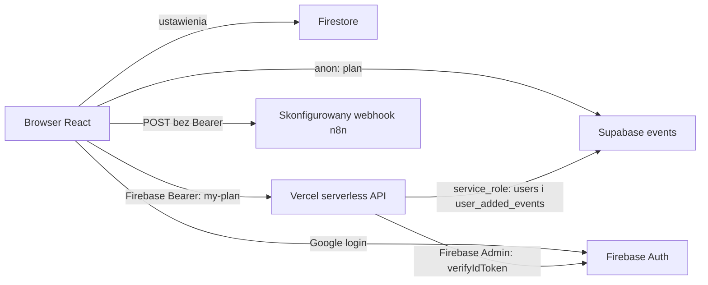

# Architektura obecna — audyt local-first AI

Data: 11.10.2026, Europe/Warsaw. Wyłącznie audyt i dokumentacja.

**POTWIERDZONE** oznacza fakt z odczytanego kodu, backupu lub wskazanego pomiaru. Fakt z backupu nie potwierdza stanu produkcji. **WYMAGA WERYFIKACJI** oznacza brak wystarczającego dowodu. **REKOMENDACJA** oznacza proponowane przyszłe zachowanie.

## Aktualizacja po odpowiedziach użytkownika

**POTWIERDZONE U1/U2:** alpha-online-account jest głównym deployem według użytkownika; Firebase Auth zostaje, n8n synchronizuje events i jest domyślnym agentem dla użytkowników strony. Odyseusz ma być opcjonalnym zamiennikiem z tym samym zestawem narzędzi, konfigurowanym endpointem użytkownika. Jeden wybrany provider na rozmowę; dodatkowy agent/globalne overrides poza PoC. Odwołane pozycje ukrywamy, dopiski obejmuje ICS, historii override’ów nie wymagamy, okno czasu 07:00–22:00. Źródłem tych ustaleń są wiadomości użytkownika z H1–H5/D-01–D-10 i potwierdzeniem U2, nie odczyt paneli.

H1 dostarcza kontekst aktualnego schematu: nullable events.faculty, nadal wymagane user_added_events.schedule_name, nowa tabela faculties; bez RLS/triggerów/akcji FK. Szczegóły i porównanie z backupem w DATABASE_AUDIT. Utrzymujemy rozróżnienie pomiędzy potwierdzonym kodem, kontekstem od użytkownika i niezależnym pomiarem runtime.

**REKOMENDACJA docelowa:** wspólny kontrakt schedule-tools, hosted adapter dla n8n i lokalny adapter dla Odyseusza. Oba wykonują te same walidowane odczyty i podglądy; zapisy dopiero po potwierdzeniu. Nie przesyłać lokalnego RAG do n8n automatycznie. Szczegóły D-07/D-08 w OVERRIDES_DESIGN zastępują wcześniejszy wariant „wyłącznie Odyseusz na PoC”.

## Wynik i granice audytu

**POTWIERDZONE:** badane repo to `wieikschedule`, gałąź `alpha-online-account`, commit `c2d131411f7df06d84f69570828537d8393e6560`. Początkowy working tree był czysty. Repo zawiera React, Firebase Auth, Firestore, Supabase i funkcje serverless; nie zawiera eksportu synchronizacji n8n. Lokalny `nasz-atlas` jest odrębną aplikacją podróżniczą ([README](../../../nasz-atlas/README.md); odwołanie do tego repo nie jest dowodem dotyczącym planu).

**POTWIERDZONE:** obecne Auth jest Firebase, a nie Supabase Auth. Prywatne operacje przechodzą przez Vercel API z kluczem `service_role`. Nie można bezpośrednio zastosować projektu `user_id REFERENCES auth.users(id)` ani uznać Firebase ID tokenu za istniejącą sesję Supabase. Dowody: A3–A5 poniżej.

**WYMAGA WERYFIKACJI:** pełne DDL/RLS/triggery/akcje FK Supabase poza podanym H1, exact origin deployu, workflow n8n i stabilność UUID, aktywny model/ścieżka RAG i zewnętrzne webhooki Odyseusza. Nie uzyskano sesji do tych paneli ani połączenia z produkcyjną bazą. Nie wykonano SQL ani POST-ów do agentów; POST czatu Odyseusza zapisuje historię.

## Rejestr dowodów

Ścieżki względne odnoszą się do repo `wieikschedule`; numery dotyczą badanego commitu.

| ID | Konkretny dowód | Ustalenie |
| --- | --- | --- |
| A1 | [package.json](../../package.json), zależności i scripts; [src/index.js](../../src/index.js), 1–14 | React 19, CRA/react-scripts 5, Tailwind 3; `start/build/test`; wejście przez AuthProvider. |
| A2 | [src/app/App.js](../../src/app/App.js), 19–150; [timetableApi.js](../../src/features/schedule/data/timetableApi.js), 27–96 | Jedna aplikacja z przełączaniem widoków w stanie; brak biblioteki routingu w zależnościach. Plan z Supabase. |
| A3 | [AuthProvider.js](../../src/features/auth/AuthProvider.js), 30–105; [firebaseClient.js](../../src/lib/firebaseClient.js), 1–33 | Google popup z fallbackiem redirect, browserLocalPersistence; Firebase Auth i Firestore. README opisuje tylko redirect i ma stare ścieżki. |
| A4 | [myPlanApi.js](../../src/features/my-plan/myPlanApi.js), 12–50; [requestAuth.js](../../api/_lib/requestAuth.js), 12–46 | Firebase `getIdToken()` → Bearer → Firebase Admin `verifyIdToken`. Brak jawnego ponowienia po 401; weryfikacja nie włącza parametru sprawdzania unieważnienia tokenu. |
| A5 | [users.js](../../api/_lib/users.js), 1–40; [supabaseAdmin.js](../../api/_lib/supabaseAdmin.js), 14–31 | Mapowanie Firebase UID na UUID `public.users.id`; backend używa service_role, wyłącza persistSession i autoRefreshToken. |
| A6 | [supabaseClient.js](../../src/lib/supabaseClient.js), 9–18; [timetableApi.js](../../src/features/schedule/data/timetableApi.js), 77–84 | Przeglądarka używa anon clienta; odczytuje 11 kolumn events, faculty wybranego planu oraz `all`, status NULL/aktywne/wolne. |
| A7 | [normalizeTimetable.js](../../src/features/schedule/data/normalizeTimetable.js), 83–132, 235–319 | NULL-e stają się wartościami prezentacji, `wolne` dotyczy wszystkich grup; DB UUID zachowany jako event_id, UI id jest przeliczanym indeksem. |
| A8 | [filterEvents.js](../../src/features/schedule/logic/filterEvents.js), 64–141; [mergeEvents.js](../../src/features/schedule/logic/mergeEvents.js), 4–24; [externalEvents.js](../../src/features/schedule/logic/externalEvents.js), 3–18 | Dokładne dates, grupy, lektoraty, wykłady; trzy źródła: podstawowy, zewnętrzne grupy, dopisane wydarzenia. |
| A9 | [timetableCache.js](../../src/features/schedule/data/timetableCache.js), 1–34; [myPlanCache.js](../../src/features/my-plan/myPlanCache.js), 1–31; [useMyPlanEvents.js](../../src/features/my-plan/useMyPlanEvents.js), 9–68 | Cache publiczny v2/15 min; prywatny po UID/planie/tygodniu, TTL 7 dni, bez utrwalania pending writes; kontrola nieaktualnych odpowiedzi. |
| A10 | [n8nClient.js](../../src/features/chat/n8nClient.js), 140–220; [useChatbot.js](../../src/features/chat/useChatbot.js), 35–127 | Browser bezpośrednio POST-uje do skonfigurowanego webhooka; brak Bearer, timeout 150 s, klientowy sessionId, parsowanie tekstu i slot_choices. |
| A11 | [selectExportEvents.js](../../src/features/schedule/export/selectExportEvents.js), 4–9; [exportICS.js](../../src/features/schedule/export/exportICS.js), 25–93; [WeekView.js](../../src/features/schedule/components/WeekView.js), 9–23 | ICS obejmuje bazowe i zewnętrzne wydarzenia, nie dopiski; UID używa UI id/subj/daty. Tydzień pon.–pt., 07:00–22:00. |
| A12 | [useSettings.js](../../src/features/settings/useSettings.js), 82–105, 145–174; [firestore.rules](../../firestore.rules), 4–22 | Ustawienia także w Firestore `/userSettings/{uid}`; reguły właściciela i kształtu dokumentu są w repo, wdrożenie niepotwierdzone. |
| D1 | [schema.sql](../../DB/Backups/06_09_2026/schema.sql), 112–124, 177–215 | Archiwalny schemat events i users. |
| D2 | [schema.sql](../../DB/Backups/06_09_2026/schema.sql), 147–158, 247, 264–285 | Archiwalne dopiski mają schedule_name NOT NULL, FK events z CASCADE; obecny add-event nie zapisuje schedule_name. |
| D3 | [schema.sql](../../DB/Backups/06_09_2026/schema.sql), 289–313, 502–561 | RLS i szerokie GRANT/default privileges w backupie; nie są pomiarem produkcji. |
| D4 | [events.csv](../../data/imports/events.csv), nagłówek i 4696 rekordów; [data.sql](../../DB/Backups/06_09_2026/data.sql), sekcja COPY events | Archiwalne słowniki. CSV nie ma id; dump ma 4696 unikalnych UUID. |

## Rzeczywiste przepływy w kodzie

**POTWIERDZONE:** to diagram ścieżek kodu A4–A6, A10, A12. **WYMAGA WERYFIKACJI:** Vercel faktycznie hostuje ten commit, env wskazują właściwy projekt, webhook n8n działa i jest chroniony. Repo nie zawiera `vercel.json`, eksportu workflow ani wersjonowanych migracji usuwających schedule_name. Archiwum `.tmp-cleanup` nie jest aktywnym kodem; stare README/docs nie mają pierwszeństwa przed importami `src/index.js`.

## Lokalny agent i sieć — pomiary 11.10.2026

Źródła runtime: `docker ps -a --format ...`, filtrowane `docker inspect`, `tailscale serve status --json`, `tailscale funnel status --json`, anonimowe GET-y na loopback. Odczytano tylko metadane i bezpieczne flagi; nie pobierano notatek, haseł, sesji ani kluczy.

| Status | Wynik i dowód |
| --- | --- |
| POTWIERDZONE | Odyseusz działa w `odysseus-odysseus-1`, obraz `ghcr.io/odysseus-dev/odysseus:latest`, image ID `sha256:76a6e615fd0bad4ecaf4cde6642409dffe888e2ddc7f21977f6bd546c524375b`. GET `/api/health`: 200; `/api/version`: 200, 1.0.3; `/api/auth/status`: configured=true, authenticated=false. |
| POTWIERDZONE | Repo Odyseusza: HEAD `2992bf6d368a11472323e47d3bfed91e79cefc6b`, istnieją lokalne zmiany. Sumy SHA-256 dziesięciu badanych plików zgadzają się z kontenerem: app.py, core/auth.py, core/database.py, routes/webhook/webhook_routes.py, routes/codex_routes.py, src/tool_approvals.py, src/tools/calendar.py, src/tool_policy.py, src/index_walk.py, src/model_capability_readers/lmstudio.py. Nie dowodzi to zgodności wszystkich plików. |
| POTWIERDZONE | Docker wystawia Odyseusza na `0.0.0.0:7000`; domyślny bind w [compose](/home/cedwukropek/odysseus/docker-compose.yml:13) to 127.0.0.1. AUTH_ENABLED=true, LOCALHOST_BYPASS=false; ALLOWED_ORIGINS to tylko http://localhost i http://127.0.0.1. |
| POTWIERDZONE | Serve 8443 proxy’uje do `http://127.0.0.1:7000`. Port 443 proxy’uje do aplikacji atlas na 3001 i ma AllowFunnel=true. Nie odnotowano AllowFunnel dla 8443. Publicznego hostname nie utrwalamy. |
| WYMAGA WERYFIKACJI | Firewall, ACL/grants tailnetu, ruch z urządzenia poza tailnetem i rzeczywiste CORS dla originu Vercel. Preflight localhost: 200 z odpowiednim ACAO. Próba obcego originu i GET chronionego endpointu zakończyły się timeoutem; nie są dowodem ani dopuszczenia, ani skutecznej odmowy. |
| POTWIERDZONE | W `docker ps -a` brak n8n/Hermes; lokalny katalog services/n8n jest pusty, brak binarnego hermes w PATH. To nie wyklucza usług na innym urządzeniu. |
| POTWIERDZONE | Syncthing działa w network_mode=host; vault `/srv/syncthing/obsidian` jest zamontowany do `/app/obsidian` w Odyseuszu jako RW. Dowody: docker inspect; [compose](/home/cedwukropek/odysseus/docker-compose.yml:17), [Syncthing compose](/home/cedwukropek/services/syncthing/compose.yml:15). |

**POTWIERDZONE:** [AuthManager](/home/cedwukropek/odysseus/core/auth.py:90) używa username i własnych sesji; [ApiToken](/home/cedwukropek/odysseus/core/database.py:634) przechowuje owner/scopes/aktywny hash tokenu. [POST /api/v1/chat](/home/cedwukropek/odysseus/routes/webhook/webhook_routes.py:229) przyjmuje token Odyseusza z zakresem chat; nie ma kontraktu Firebase/Supabase JWT ani czterech narzędzi schedule. Wywołuje model, utrwala sesję i emituje `chat.completed` z fragmentem wiadomości/odpowiedzi (376–391). Nie jest gotowym izolowanym agentem harmonogramu.

**POTWIERDZONE:** istnieją [calendar endpoints](/home/cedwukropek/odysseus/routes/codex_routes.py:420) i [manage_calendar](/home/cedwukropek/odysseus/src/tools/calendar.py:19); operują na lokalnym CalendarEvent/CalDAV, nie Supabase events. [Zatwierdzenia](/home/cedwukropek/odysseus/src/tool_approvals.py:1) obejmują też zadanie/czat, więc nie zapewniają automatycznie potwierdzenia każdego zapisu. [Tool policy](/home/cedwukropek/odysseus/src/tool_policy.py:53) zna m.in. bash/python/api_call; nie wystarczy ukryć ich w UI.

**POTWIERDZONE:** [czytnik LM Studio](/home/cedwukropek/odysseus/src/model_capability_readers/lmstudio.py) istnieje. **WYMAGA WERYFIKACJI:** aktywny endpoint, model, tool-use i embeddings. Nie uruchamiano skanowania sieci ani generacji modelu. [index_walk](/home/cedwukropek/odysseus/src/index_walk.py:19) pomija ukryte podkatalogi; nie jest to polityka dostępu do zatwierdzonych notatek.

## Najważniejsze ryzyka i kolejność

1. **WYMAGA WERYFIKACJI:** UUID i twarde usuwanie przez n8n. Backup ma domyślne losowe UUID oraz CASCADE istniejących dopisków/tagów; nie dowodzi stabilności synchronizacji (D1–D2).
2. **POTWIERDZONE:** rozbieżność Auth oraz backup–kod w schedule_name (A3–A5, D2). Najpierw aktualny schema-only dump, następnie decyzja Auth.
3. **REKOMENDACJA:** prywatne nakładki poza wspólnym cache, oparte na event_id; jedno wyliczenie effective events dla dnia, tygodnia, konfliktów i eksportu. Konkretne miejsca: A7–A11.
4. **REKOMENDACJA zgodna z U1:** wspólne API czterech narzędzi dla domyślnego n8n i opcjonalnego Odyseusza, z odrębnymi hosted/lokalnymi adapterami. Lokalnie HTTPS Serve i dokładny CORS; token użytkownika dostępny tylko warstwie autoryzacji. Konta A/B to test izolacji, nie ograniczenie produktu do jednego użytkownika. Szczegóły w [projekcie](OVERRIDES_DESIGN.md).

Normy sieciowe zweryfikowano w dokumentacji: Serve udostępnia usługę tailnetowi, Funnel publicznie ([Serve](https://tailscale.com/docs/features/tailscale-serve), [Funnel](https://tailscale.com/docs/features/tailscale-funnel)). Dostęp z publicznej strony do lokalnej sieci może wymagać zgody przeglądarki; Chrome wdraża Local Network Access ([Chrome](https://developer.chrome.com/blog/local-network-access)). Zachowanie dla konkretnego DNS/IP Tailscale trzeba przetestować na urządzeniach użytkownika.

## RAG Odyseusza — co dzieje się automatycznie

**POTWIERDZONE w kodzie:** [routes/chat_helpers.py](/home/cedwukropek/odysseus/routes/chat_helpers.py:1192) uruchamia ekstrakcję pamięci po odpowiednich odpowiedziach, gdy pozwalają auto_memory/tryb rozmowy, bez incognito/compare. To nie jest automatyczne indeksowanie wszystkich plików. [PersonalDocsManager](/home/cedwukropek/odysseus/src/personal_docs.py:211) wczytuje zarejestrowane katalogi i odświeża lokalny indeks przy inicjalizacji; [add_directory](/home/cedwukropek/odysseus/src/personal_docs.py:276) indeksuje nowo dodany katalog, gdy jest rag_manager. [Upload route](/home/cedwukropek/odysseus/routes/personal_routes.py:375) dodaje fragmenty uploadu do indeksu, a [chat_processor](/home/cedwukropek/odysseus/src/chat_processor.py:361) pobiera wyniki przy use_rag i spełnionym progu podobieństwa.

**WYMAGA WERYFIKACJI:** aktywne ustawienia konkretnego użytkownika, zarejestrowanie vaultu, zasięg dozwolonych ścieżek, lokalność embeddings/modelu i odświeżenie zmienionych plików przez Syncthing. W badanych ścieżkach nie wykazano watchera automatycznie reindeksującego każdą zmianę pliku. Sam mount Obsidiana nie rejestruje folderu do RAG. `/api/v1/chat` wywołuje llm_call_async bez standardowego chat_processor/fire_post_response_tasks; prosty adapter oparty wyłącznie na nim nie dziedziczy automatycznej pamięci ani RAG. Dlatego preferowany adapter ma zachować native sesję/ścieżkę agentową Odyseusza, z kontraktem sprawdzonym na kopii.

**REKOMENDACJA:** wykorzystać istniejący indeks/pamięć zamiast budować nowy RAG w aplikacji planu. Wiedza o aktualnym planie nadal pochodzi z narzędzi Supabase, bo stara pamięć rozmowy nie jest aktualnym harmonogramem. Skills pomagają modelowi wybrać narzędzie, ale walidacja/uprawnienia należą do API/MCP.
