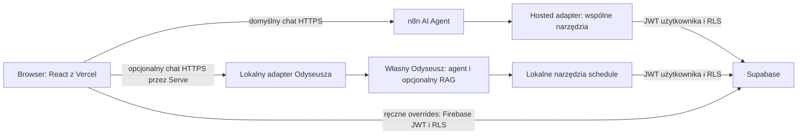

# Projekt override’ów i wymiennych agentów n8n/Odyseusz

Audyt bazowy: 11.10.2026; aktualizacja: 14.10.2026. **REKOMENDACJA:** cały poniższy projekt opisuje przyszłe zachowanie, nie wdrożoną funkcję. Fakty i ograniczenia: [architektura](ARCHITECTURE_AS_IS.md), [baza](DATABASE_AUDIT.md). **WYMAGA WERYFIKACJI:** aktualne DDL/Auth, stabilne UUID i uzgodnione usuwanie źródeł przed pierwszym override’em.

## Stan bramek po dostarczeniu workflow

**POTWIERDZONE N1/U3:** n8n nie jest jeszcze uruchomione na serwerze, a dostarczony importer nie zapewnia stabilnych UUID i pomija część danych. G0 niezaliczone; nie wdrażać schedule_overrides przed naprawą importera. RLS events zostało potwierdzone przez użytkownika, ale nie zastępuje nowych polityk prywatnych overrides. Wyniki z konkretnych node’ów są w ARCHITECTURE_AS_IS/MIGRATION_PROPOSAL.

**REKOMENDACJA:** publiczny agent planu trzeba przygotować jako nowy workflow jednego AI Agent z narzędziami schedule. Auto To Do Agent (N4) jest przykładem pracy na projektach/notatkach i trzech agentach specjalistycznych, nie gotowym agentem harmonogramu; nie importować go jako publicznego agenta planu ani podłączać tools Google Drive/executeCommand. Instalacja n8n i aktywacja workflow pozostają przyszłą, osobno zatwierdzaną zmianą środowiska.

## Tożsamość i schemat

**POTWIERDZONE U1:** Firebase Auth zostaje, bez migracji kont; user_id override wskazuje public.users.id. Podany przez użytkownika schemat opisano w DATABASE_AUDIT. **REKOMENDACJA:** dodać Firebase jako Third-party Auth w Supabase, aby nowe narzędzia obu agentów działały przez JWT użytkownika i RLS bez service_role. Google login i istniejące Vercel my-plan API zostają; osobny klient obsługuje nowe overrides. To wymaga konfiguracji zaufania i claims, nie zmiany dostawcy logowania ([Supabase: Firebase Auth](https://supabase.com/docs/guides/auth/third-party/firebase-auth)). Decyzja pozostawienia Firebase nie jest automatycznym zatwierdzeniem zmian panelu/claims.

| Pole schedule_overrides | Projekt |
| --- | --- |
| id | UUID PK, generowany przez DB |
| event_id | UUID NOT NULL, FK public.events(id); RESTRICT dla DELETE i zmiany PK |
| user_id | UUID nullable, FK public.users(id), ON DELETE CASCADE |
| scope | TEXT NOT NULL: personal/global |
| action | TEXT NOT NULL: modify/cancel |
| patch | JSONB NOT NULL, obiekt, default `{}` |
| reason | TEXT nullable, limit 1000 znaków; nie kopiować automatycznie notatek/promptu |
| created_at / updated_at | TIMESTAMPTZ NOT NULL, nadawane przez DB; aktualizacja przez trigger |
| revision | dodatkowe INTEGER NOT NULL default 1, zwiększane przy zmianie; CAS przy zapisie/usuwaniu |

CHECK: personal wymaga user_id, global wymaga user_id IS NULL. modify wymaga niepustego patch; cancel wymaga dokładnie `{}`. Scope/action/user/event/created_at nie są zmieniane przez edycję patch. Usuń override fizycznie na PoC — oznacza przywrócenie źródła, nie usunięcie events; historia nie wymaga kolejnej tabeli na tym etapie. Prywatne dane w kopii bazy podlegają tej samej polityce retencji co obecny plan.

Fragment **projektowy**, niewystarczający do wdrożenia bez walidacji/RLS:

```sql
CHECK ((scope='personal' AND user_id IS NOT NULL)
    OR (scope='global' AND user_id IS NULL));
CHECK (action IN ('modify','cancel'));
CHECK (jsonb_typeof(patch)='object');
CHECK ((action='cancel' AND patch='{}'::jsonb)
    OR (action='modify' AND patch<>'{}'::jsonb));
CREATE UNIQUE INDEX schedule_overrides_personal_unique
  ON public.schedule_overrides(user_id,event_id) WHERE scope='personal';
CREATE UNIQUE INDEX schedule_overrides_global_unique
  ON public.schedule_overrides(event_id) WHERE scope='global';
CREATE INDEX schedule_overrides_event_idx ON public.schedule_overrides(event_id);
```

Jeden istniejący prywatny override = jeden aktywny override dla użytkownika/wydarzenia. Ponowny create_override z istniejącym wpisem zastępuje cały zatwierdzony patch w tej samej pozycji po sprawdzeniu revision. Nie scalać ukradkiem starych kluczy; podgląd pokazuje pełny wynik. Równoległe utworzenie: unikalny indeks rozstrzyga konflikt, API zwraca 409 i nowy podgląd.

## Allowlista patch zgodna z D1 i aktualnym UI

Typy z dostarczonego H1 potwierdzają poniższą propozycję; RLS i triggery pozostają do odczytu. **POTWIERDZONE U1:** okno 07:00–22:00. **REKOMENDACJA:** allowlista jest mniejsza niż schema events, aby zachować filtry i źródłowe dane.

| Klucz | Wartość dopuszczona na PoC | JSON null |
| --- | --- | --- |
| date | prawidłowy dzień ISO YYYY-MM-DD, pon.–pt.; kontrola rzeczywistej daty | odrzucić |
| start_time | HH:mm:ss z sekundami 00, 07:00–22:00 | odrzucić |
| duration_min | liczba JSON będąca dodatnią liczbą całkowitą, 1–900; nie string/boolean | odrzucić |
| room | string, limit 256 znaków | ustawić NULL |
| instructor | string, limit 256 znaków | ustawić NULL |

Po zmianie czasu/duration wynik kończy się tego samego dnia najpóźniej o 22:00. Nie narzucać nowego zakresu czasu przy samym wyczyszczeniu sali w istniejącym wydarzeniu specjalnym. Pon.–pt. to propozycja zachowania zgodnego z obecnym WeekView, nie osobna zaakceptowana decyzja użytkownika. Nie wprowadzać dodatkowej ręcznej konfiguracji zakresu semestru na PoC; zakres nawigacji wyliczać z danych i nowych dat.

Limity tekstu 256/1000 znaków są propozycją zabezpieczenia wejścia przed przypadkowym wklejeniem dużej treści. Duration mieści się w 15-godzinnym oknie (maks. 900 min przy starcie 07:00). Limit 100 wyników oznacza wielkość strony, nie maksymalną liczbę zajęć. Limit 31 dni dotyczy jednego wywołania modelowego, nie ograniczenia całego kalendarza.

PoC odrzuca wszystkie pozostałe klucze: id, faculty, group, type, status, subject, user_id, event_id, scope, metadane, klucze zagnieżdżone/operatorowe. To zachowuje semantykę wyboru planu, grup i rozpoznawania lektoratów (A6–A8). Rozszerzenie subject/type/group/status wymaga oddzielnego audytu filtrów, nie arbitralnego JSON.

Brak klucza zachowuje oryginał; jawne null czyści wyłącznie nullable pole. Zasada:

```text
effective[field] = ownKey(patch, field) ? patch[field] : source[field]
```

Nie używać `patch.room ?? source.room`, `||` ani `COALESCE` do nakładania zmian: zgubią jawne null. Raw source pozostaje bez zmian. Walidator DB/trigger musi kontrolować klucze i typy również przy bezpośrednim dostępie przez Data API; UI i lokalne API powtarzają walidację dla czytelnego błędu. Normalizacja prezentacji następuje po zastosowaniu patch. PostgreSQL rozróżnia obecność klucza i JSON null ([operatory JSON](https://www.postgresql.org/docs/current/functions-json.html)).

cancel nie ustawia events.status na nieznaną wartość. Wylicza `is_cancelled=true` oraz prywatny powód; źródłowe status/faculty/type i NULL-e zostają. Domyślnie odwołane wydarzenie znika z listy zajęć/konfliktów/eksportu, a osobny podgląd zmian pozwala je przywrócić. „Odwołaj tylko dla mnie” dotyczy także wolne/all i wymaga konkretnego potwierdzenia; nie oznacza oficjalnego odwołania uczelnianego.

## RLS i role

Nie projektować polityki `auth.uid() = user_id` dla Firebase tekstowego sub. Tożsamość DB:

1. Zaufany Firebase token: poprawne issuer/audience/role dla ustalonego projektu. Żadnego zaufania do UID z body.
2. Niewielka funkcja bez argumentu `current_schedule_user_id()` zwraca UUID public.users dla `auth.jwt()->>'sub'`. SECURITY DEFINER tylko do tego odczytu, stały search_path=pg_catalog, pełne kwalifikowanie public.users/auth.jwt, bez dynamicznego SQL i dowolnego UID. Sprawdza także issuer/audience. REVOKE EXECUTE od PUBLIC/anon, GRANT tylko authenticated. Nie ujawnia całej tabeli users ani role.
3. RLS SELECT/DELETE: scope=personal AND user_id=current_schedule_user_id(). INSERT WITH CHECK i UPDATE USING/WITH CHECK z tym samym warunkiem. Trigger chroni immutable fields i revision; default user_id pochodzi z mapowania. Brak mapowania → kontrolowany błąd, brak zapisów.
4. anon nie ma dostępu do prywatnych overrides. authenticated otrzymuje tylko niezbędne SELECT/INSERT/UPDATE/DELETE; wycofać odziedziczone szerokie granty nowej tabeli i funkcji (D3). Zwykli użytkownicy/agent nie mają polityk dla global; każda próba global zwraca odmowę.

Na PoC global jest reprezentowalne w schemacie, ale nie ma przepływu tworzenia ani odczytu global w aplikacji. Administracyjne role public.users nie są jeszcze podstawą nowych globalnych uprawnień. PoC nie zmienia istniejących polityk dopisków/tagów na szerokie „authenticated USING true”.

Granty i RLS są osobnymi kontrolami; widok effective_events w przyszłości wymaga kontroli tożsamości i RLS, np. security_invoker na obsługiwanej wersji Postgresa ([Supabase RLS](https://supabase.com/docs/guides/database/postgres/row-level-security)). Na początek zalecane składanie w kodzie zamiast widoku/RPC wykonującego arbitralne operacje.

## Minimalne wpięcie do React

Punktem nakładania są surowe events przed normalizacją i przed filtrem dates/grup. `event_id` odpowiada DB UUID; przeliczany numeryczny `id` UI z normalizeTimetable 317 nie jest tożsamością zapisu. Zachować raw rows w publicznym cache, wyliczać osobny prywatny effective timetable. Cache publiczny nie może zostać nadpisany wynikiem dla zalogowanego użytkownika.

Pipeline: raw bazowe i zewnętrzne → prywatne overrides po UUID → normalizacja → dotychczasowe filtry i merge. Te same overrides obejmują dopiski przez event_id, zachowując added_event_id/origin. Po cancel żaden dopisek ani zewnętrzna kopia nie może ponownie wstawić odwołanego event_id; deduplikacja rozróżnia różne rzeczywiste UUID. Nakładka nie dopisuje użytkownikowi wydarzenia spoza jego wybranych źródeł/grup.

Po zmianie date ponownie wyliczyć day/dates/minDate/maxDate. Przy obecnym pobieraniu całego planu przeniesienie między tygodniami nie wymaga szukania tylko po pierwotnej dacie. Jeżeli loader zostanie ograniczony datami, pobierać także źródłowe id override’ów, których nowa data trafia w okno. Dla dopisków uwzględnić ten przypadek mimo ich obecnego API filtrowanego po źródłowej events.date.

Jedno źródło effective events dla WeekView, DayView, konfliktów i eksportu. Obecny selectExportEvents pomija dopiski (A11). **POTWIERDZONE U1:** eksport ma obejmować także dopiski i pomijać odwołane pozycje. Ujednolicić selektor eksportu dla bazy, zewnętrznych grup i wszystkich potwierdzonych dopisków w wybranym zakresie; nie brać tylko cache tygodnia widocznego w UI. Dopiski mają dziś API z filtrem daty — pobrać pełny zakres eksportu i uwzględnić nowe daty override’ów. Stabilny UID ICS oprzeć o event_id, nie UI indeks ani edytowaną datę/tytuł; sprawdzić skutki ponownego importu kalendarza.

Override cache na PoC tylko w pamięci i pod UID. Po zmianie konta/wylogowaniu opróżnić stan, unieważnić pending approvals i odrzucić spóźnione odpowiedzi. Błąd odczytu overrides nie oznacza pustej tabeli: UI pokazuje stan nieaktualny i blokuje nowe zapisy; nie może przedstawiać odwołanego wydarzenia jako potwierdzonego. Bez Tailscale działa ręczne UI i odczyt prywatnych overrides z Supabase.

## D-07/D-08 — wspólny kontrakt, dwa wybierane providery

**POTWIERDZONE U1/U2:** domyślny agent to n8n, dostępny dla użytkowników strony. Odyseusz to opcjonalny zamiennik skonfigurowany przez użytkownika; n8n nadal osobno synchronizuje events. W danej rozmowie działa jeden wybrany provider. Oba tryby mają te same nazwy, schematy wejścia, odczyt danych, kontrolę właściciela, podgląd, błędy i potwierdzenia. Nie tworzymy dwóch współpracujących agentów ani frameworka orkiestracji.



**REKOMENDACJA:** jeden niewielki pakiet schedule-tools/adapter, wdrażany obok publicznego n8n oraz lokalnie obok Odyseusza. Najpierw stabilny HTTP/JSON kontrakt; dla Odyseusza cienki wrapper MCP nad tą samą implementacją. n8n może wywoływać te same operacje przez zamknięte HTTP subworkflows, a gdy eksport potwierdzi zgodność — przez MCP. Nie kopiować walidacji na różne niezależne Code nodes. Serwis nie potrzebuje nowej bazy, kolejki ani kontenera modelu. Nie ma obecnego wdrożenia n8n na serwerze (U3): przygotować osobne testowe wdrożenie z przypiętą wersją, trwałym stanem i sekretem szyfrowania credentials poza GitHubem. Publiczny chat wymaga HTTPS/Auth/rate limit; panel administracyjny utrzymać prywatnie. Host/publiczny origin ustalić dopiero przed uruchomieniem.

Publiczny frontend z Vercel wywołuje wybrany agentowy endpoint bez proxy czatu w Vercel. Dotychczasowe Vercel API my-plan nadal obsługuje swoją funkcję. Użytkownicy zalogowani korzystają z własnego kontekstu Firebase; goście, jeśli obecny produkt pozwala na chat, mają wyłącznie publiczne odczyty. Zapis prywatnego planu wymaga logowania i konkretnego potwierdzenia. Brak konfiguracji Odyseusza oznacza użycie n8n, nie błąd produktu.

Lokalny i hosted adapter nie dostają service_role, sekretu podpisywania JWT ani Firebase admin private key. Używają publicznego klucza Supabase i krótkotrwałego JWT użytkownika. Model nie dostaje bearer tokenu ani credential do DB. Trusted wrapper wiąże kontekst wykonania z UID, sesją i ownerem; nie przyjmuje user_id wybieranego przez LLM. n8n nie zapisuje nagłówków Authorization ani credential w danych wykonania/promptach. Nie utrwalać tokenów użytkowników jako wspólnego credential workflow.

| Narzędzie | Wspólny kontrakt obu providerów |
| --- | --- |
| schedule.get_events | zakres/plan, paginacja, raw + effective, NULL i specjalne wydarzenia; zero dowolnego SQL/URL |
| schedule.find_event | UUID lub ograniczone kryteria, lista kandydatów; niejednoznaczność → wybór użytkownika |
| schedule.create_override | event_id/action/pełny patch/reason/expected revision; zwraca podgląd i approval_id, bez zapisu |
| schedule.delete_override | własny override_id/revision; podgląd przywrócenia i approval_id, bez zapisu |

Dotychczasowe slot_choices i ręczne add/remove my-plan pozostają kompatybilne. Pierwsze cztery narzędzia dotyczą overrides, nie tworzenia nowych rekordów events. Ewentualne agentowe add/remove dopisków powinny opakować istniejące my-plan operacje w ten sam protokół właściciela i potwierdzenia; nie są powodem nadania agencjom INSERT/DELETE events.

## Lokalna konfiguracja użytkownika

**REKOMENDACJA:** w ustawieniach strony wybór „n8n” / „Mój Odyseusz”. Dla lokalnego trybu pole „Endpoint”, test połączenia i czytelny stan zgodności. Operator lokalnego Odyseusza instaluje raz adapter/pakiet narzędzi oraz konfiguruje jego połączenie z własnym kontem Odyseusza. Wtedy użytkownik strony wpisuje endpoint adaptera, np. HTTPS Serve na własnym urządzeniu, a adapter zna native URL i lokalny token Odyseusza po stronie serwera. Nie wpisuje service_role ani admin key w UI.

Sam dzisiejszy native URL Odyseusza nie spełnia jeszcze tego kontraktu: `/api/v1/chat` wymaga tokenu ody_ i wywołuje zwykły model, bez standardowej ścieżki agentowej/RAG ([sync_chat implementation](/home/cedwukropek/odysseus/routes/webhook/webhook_routes.py:229)). Docelowy adapter korzysta z właścicielskiej sesji i właściwej ścieżki native chatu/agenta oraz MCP schedule; adapter normalizuje response i approvals. Dokładny kontrakt `/api/chat`/scopes/form/SSE i mapowanie ownera trzeba potwierdzić testem na kopii. Nie gwarantować automatycznej pamięci/RAG przy użyciu prostego `/api/v1/chat`.

Endpoint jest ustawieniem per użytkownik/urządzenie; żadnego tokenu Odyseusza w bundle, localStorage ani Firestore. Przed wysłaniem tokenu Firebase do własnego adaptera użytkownik świadomie zatwierdza konkretny origin; najpierw publiczny GET capabilities bez credentials. Dopuszczone HTTPS, bez credentials w URL. Publiczny n8n/backend nigdy nie pobiera dowolnego endpointu podanego przez browser. Zmiana endpointu/provideru tworzy nową sesję, czyści approvals i nie wysyła poprzedniej historii automatycznie do drugiej usługi.

Przy niedostępnym Odyseuszu: komunikat i możliwość świadomego przełączenia na n8n; brak automatycznego przesyłania lokalnych notatek/historii do chmury. Generacja i RAG mogą działać całkowicie lokalnie, jeśli model i embeddings są lokalne. Firebase, hosting frontendu i Supabase pozostają elementami dotychczasowej aplikacji.

Skills Odyseusza opisują sposób pracy i wybór narzędzi, ale same nie nadają funkcji ani uprawnień. Narzędzia schedule muszą rzeczywiście istnieć w API/MCP; ich serwer narzuca allowlistę, własność i approvals. Istniejące MCP w Odyseuszu umożliwia takie rozszerzenie bez zakładania forka core ([mcp_manager.py](/home/cedwukropek/odysseus/src/mcp_manager.py:339), [mcp routes](/home/cedwukropek/odysseus/routes/mcp/mcp_routes.py:381)). Możliwość n8n jako MCP klienta jest opisana w [oficjalnej dokumentacji node’a](https://github.com/n8n-io/n8n-docs/blob/main/docs/integrations/builtin/cluster-nodes/sub-nodes/n8n-nodes-langchain.toolmcp.md); jej dostępność w konkretnej wersji n8n wymaga odczytu eksportu.

Zatwierdzenie UI jest oddzielnym wywołaniem trusted adaptera, nie narzędziem modelu. Wszystkie mutacje i ograniczenia z następnej sekcji obowiązują n8n i Odyseusza. Rozmiary żądań, strony wyników i kroki modelu są ograniczone technicznie; produkt nie ma limitu liczby wydarzeń wynikającego z tych zabezpieczeń. Publiczny n8n musi mieć izolację sesji użytkowników i rate limiting; sam losowy sessionId podany przez browser nie potwierdza właściciela.

## Potwierdzenie każdej mutacji

1. Wybrany adapter weryfikuje użytkownika, event, allowlistę i wynik; zapisuje w pamięci podgląd operacji związany z UID, event_id/override_id, action, pełnym patch, reason, revision oraz fingerprintem raw events. Random approval_id, TTL 5 min. Digest nie jest uprawnieniem klienta.
2. UI pokazuje źródło → wynik, dotknięty termin i „tylko dla mnie”. Człowiek klika zatwierdzenie konkretnej operacji; model nie może potwierdzić, wystawić approval_id ani podmienić zawartości.
3. API ponownie sprawdza token/własność/fingerprint i revision; zmiana przez n8n/drugą kartę → 409 i nowy podgląd. Zapis/DELETE atomowy z oczekiwaną revision; unikalny klucz chroni równoległe tworzenie. Wąski RPC blokuje konkretny event/override i porównuje fingerprint oraz revision w tej samej transakcji, bez dynamicznego SQL i bez pominięcia RLS. Odczyt fingerprintu w API przed osobnym INSERT nie chroni przed zmianą źródła w międzyczasie; sam retry nie rozwiązuje tego wyścigu.
4. Approval jednorazowy; powtórzenie zwraca wynik poprzedniej próby w rejestrze wybranego adaptera. Timeout po możliwym commit → odczyt aktualnego wiersza, bez automatycznego ponowienia w ciemno. Restart adaptera unieważnia approvals; nie usuwa override’ów. Po zmianie konta brak wznowienia zapisu.

Każdy kolejny zapis i każde delete wymaga nowego potwierdzenia, niezależnie od wyboru n8n/Odyseusza. Istniejące zatwierdzenie całego czatu/zadania Odyseusza nie spełnia tego warunku. RLS chroni własność, nie udowadnia kliknięcia człowieka; bezpośredni zapis właściciela własnym tokenem jest poza protokołem agenta. Dlatego token nie trafia do runtime modelu, a ręczne UI ma własny podgląd i przycisk zatwierdzenia. Jeśli wymagany jest dowód potwierdzenia także na poziomie DB dla każdego klienta, potrzebny jest osobny zatwierdzony projekt kontrolowanego RPC i uwierzytelnienia gateway — nie ukrywać tego kosztu.

Sieć lokalna: nowy adapter wyłącznie loopback + Serve HTTPS, bez Funnel; nie resetować istniejącego 443/8443. CORS dokładnie zatwierdzone originy Preview/Production, bez wildcard/odbicia Origin. Authorization/Content-Type dopuszczone w preflight; brak potrzeby cross-site cookies. Vercel CSP connect-src musi uwzględnić API. CORS nie zastępuje Auth ani ACL. Testować LNA/DNS/TLS na przeglądarce użytkownika. 401 → jednorazowe odświeżenie Firebase tokenu, dalsza odmowa → ponowne logowanie; zapis nie jest ponawiany bez sprawdzenia wyniku. 403/404/409/422/429/503 mają jawne stany, bez wypisywania tokenów/promptów/notatek w logach.

Lokalne API weryfikuje podpis JWT za pomocą sprawdzonej biblioteki i publicznych kluczy Firebase, z dozwolonym algorytmem, właściwymi issuer/audience, exp/iat/auth_time i niepustym sub; obsługuje rotację kluczy oraz cache zgodnie z nagłówkami źródła. Nie wystarczy dekodowanie payloadu. Szczegóły wymagań: [Firebase: Verify ID Tokens](https://firebase.google.com/docs/auth/admin/verify-id-tokens). Weryfikacja publicznego podpisu nie daje natychmiastowej informacji o unieważnieniu konta/sesji: istniejący token może pozostawać ważny do exp. PoC wymaga czyszczenia approvals po wylogowaniu i ponownej walidacji przy zapisie; jeśli natychmiastowe odcięcie tokenów jest wymogiem, trzeba zatwierdzić osobny mechanizm revocation bez przekazywania administracyjnych credentials agentowi.
