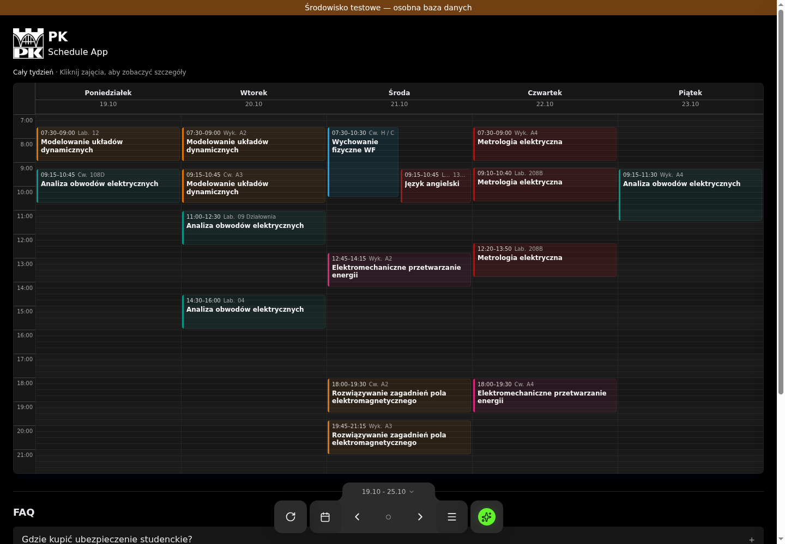
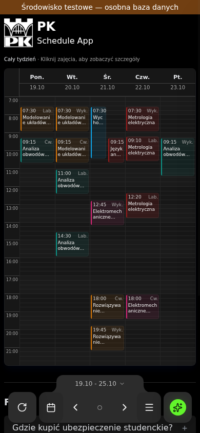
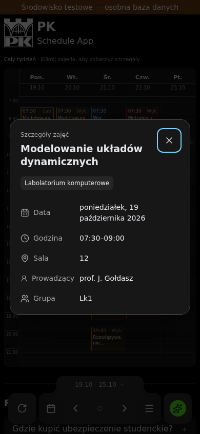

# Widok całego tygodnia

Tydzień poniedziałek–piątek mieści się na szerokość ekranu. Siatka zachowuje
zakres 07:00–22:00 i pozycjonowanie według czasu, z równoległymi kolumnami
dla nakładających się zajęć. Wysokość dostosowuje się do okna, z minimum
zapewniającym widoczne bloki. Na niskich ekranach można przewijać pionowo.

Karty pokazują nazwę przedmiotu, godzinę rozpoczęcia i skrót rodzaju zajęć;
na większych ekranach również godzinę końca i salę. Długie nazwy są skracane
w siatce. Kolor przedmiotu pozostaje w tle i na bocznym pasku, a tekst ma
jasny, spójny kolor. Wszystkie pełne informacje są dostępne po kliknięciu.

Szczegóły otwierają natywny modal dialog: pełna nazwa, konkretna data,
godziny, sala, prowadzący i grupa. Zalogowany użytkownik może przejść do
istniejącego podglądu prywatnej zmiany jednego wystąpienia; dopisane zajęcia
można usunąć istniejącą akcją. Samo otwarcie lub zamknięcie nie zapisuje zmian.
Tryb dzienny oraz kontrakty API pozostają bez zmian.

Modal działa na dotyk, mysz i klawiaturę, blokuje tło, zamyka się przez Escape,
przycisk lub kliknięcie tła i przywraca fokus do karty. Zmiana tygodnia albo
listy wydarzeń zamyka stare szczegóły. Popup jest renderowany poza elementem
eksportu PNG, który nadal obejmuje całą siatkę.

## Weryfikacja

- 58 testów React przeszło, w tym cztery nowe przypadki: podgląd konkretnej
  daty i przekazanie właściwego UUID do edycji, zmiana tygodnia, usuwanie
  dopisku z obsługą błędu, nakładanie zajęć i zamknięcie popupu.
- Chromium, pusty profil gościa, publiczny plan EiAs3 z tygodnia 19.10.2026:
  szerokości 320, 390, 768 i 1440 px. Bez poziomego przewijania siatki.
- Prawdziwe kliknięcie w kartę, Escape, przywrócenie fokusu oraz brak
  akcji prywatnej dla gościa sprawdza `ops/staging/review-week.cjs` przez CDP.
  Skrypt wymaga Node 22+ i osobnej przeglądarki z debuggerem na loopback 9223.
  Używa wyłącznie własnego profilu gościa; nie uruchamiać go na prywatnym profilu.
- Rzeczywista edycja zalogowanego użytkownika wymaga jego kliknięcia i
  potwierdzenia. Nowe testy sprawdzają przekazanie pojedynczego UUID;
  dotychczasowe testy formularza i potwierdzania zmian nadal przechodzą.

## Podgląd

