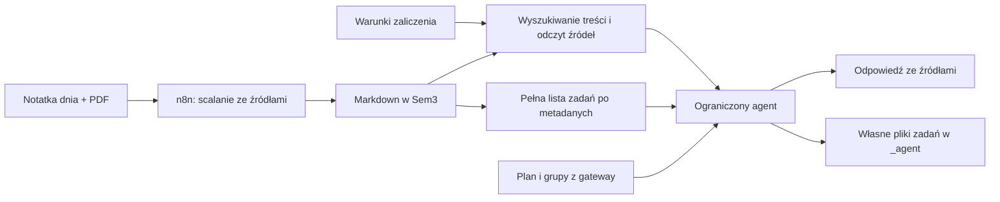

# Notatki Sem3, wymagania zaliczenia i terminy — propozycja PoC

Status: projekt do kolejnego etapu. Ta zmiana wdraża filtry i karty planu;
nie montuje notatek w agencie planu, nie indeksuje ich i nie zmienia vaulta.

## Co istnieje

Główny Odysseus ma montowanie `/srv/syncthing/notes` → `/app/obsidian` (rw).
Podany katalog `/app/obsidian/obsidian/Sem3` istnieje; podczas sprawdzenia miał
7 podfolderów i 12 plików Markdown. Sprawdzono tylko strukturę, bez czytania treści.
Osobny Odysseus agenta planu nie ma tego montowania. Własny mechanizm RAG Odysseusa
ma indeksowanie dokumentów oraz wyszukiwanie z filtrem właściciela; samo
zamontowanie folderu nie gwarantuje indeksacji ani aktualizowania wyników.

## Katalog dla agenta

Sem3 jest dobrym zakresem dostępu narzędzi studenckich. Nie wymaga przenoszenia
całego vaulta ani otwierania Sem3 jako nowego vaulta w Obsidianie. Proponowane
wiązanie: źródłowy Sem3 jako `/app/study-notes` tylko do odczytu, a wydzielony
`_agent` z prawem zapisu dla tworzonych zadań i notatek. Pozostałe notatki,
folder concepts i konfiguracja Obsidiana nie są potrzebne w tym PoC.

Katalog przypisujemy do konta Odysseusa. Ścieżki wybiera właściciel w konfiguracji,
a nie model w argumentach narzędzia. Odrzucamy wyjście poza katalog, również przez
symlinki. Czytanie własnych notatek nie wymaga parowania baz Firebase/Supabase.

Nie zmieniamy układu istniejących notatek ani ustawień głównego Odysseusa.
Obsidian URI z `vault` i `file` pozwala otworzyć plik po ścieżce względem vaulta;
cytowanie powinno używać tej ścieżki, nie kontenerowego `/app/...`, którego nie
ma na urządzeniu użytkownika. [Oficjalna dokumentacja Obsidian URI](https://help.obsidian.md/Extending+Obsidian/Obsidian+URI).

## Źródła i odpowiedzialność za zapis

Proponowana struktura pojedynczego przedmiotu:

```text
Przedmiot/
  warunki-zaliczenia.md         # aktualne wymagania i źródło
  2026-10-20.md                 # notatka z jednych zajęć
  2026-10-27.md
  podsumowanie.md               # opcjonalne, pochodne
_agent/
  zadania/<task-id>.md          # agent zapisuje własne pliki
```

n8n łączy notatkę z konkretnego dnia z pasującym PDF-em, tworząc czytelny Markdown
z odnośnikami do obu źródeł. Zachowujemy pliki źródłowe i datę zajęć. Jedno ogromne
podsumowanie całego semestru może służyć do nawigacji, ale nie powinno zastępować
źródeł: łatwo zgubić datę, grupę lub informację, który termin zastępuje poprzedni.
PDF-y wymagające OCR i nieczytelne fragmenty oznaczamy w wyniku, bez zgadywania.

Przykład metadanych notatki, niezależny od rzeczywistych plików użytkownika:

```yaml
---
id: mud-2026-10-20-laboratory-lk5
type: lesson
semester: Sem3
subject: Modelowanie układów dynamicznych
kind: laboratory
group: Lk5
lesson_date: 2026-10-20
source_files:
  - materialy/2026-10-20.pdf
  - notatki-surowe/2026-10-20.md
generated_by: n8n
updated_at: 2026-10-20T18:00:00+02:00
---
```

Daty w przykładzie to dane demonstracyjne, nie terminy z rzeczywistego planu.
Mapowanie przedmiotu i grupy powinno korzystać ze wspólnej listy/aliasów, np. MUD,
zamiast polegać na podobnych nazwach folderów. UUID wystąpienia z planu może być
dodatkowym powiązaniem, ale nie zastępuje identyfikatora zadania ani źródła.

## Dwa sposoby odczytu

**Pytania o treść:** wyszukiwanie po przedmiocie, dacie, nagłówkach i tekście,
następnie odczyt wybranych fragmentów. Przy obecnych 12 plikach wystarczy lokalne
przeszukiwanie Markdown; opcjonalny, odbudowywalny indeks SQLite FTS. Embeddingi
i dodatkowa baza wektorowa nie są warunkiem PoC.

**Pytania o wszystkie zadania w okresie:** lista rekordów z metadanych, filtrowana
po terminie, przedmiocie, grupie i statusie. Nie używamy wyłącznie podobieństwa
semantycznego ani top-k. Wynik musi rozróżniać brak zadań od nieprzeczytanego lub
nieprawidłowego pliku. Zadania bez rozstrzygniętego terminu pokazujemy osobno.

Pliki `.md` pozostają źródłem danych. Indeks to cache do odbudowy; dodanie,
zmiana, przeniesienie i usunięcie pliku muszą aktualizować cache. Przy indeksie
wektorowym stare fragmenty tej samej notatki trzeba usuwać/zastępować.



## Terminy i zadania

Przykładowy plik `_agent/zadania/<task-id>.md`:

```yaml
---
id: mud-report-03-lk5
type: task
subject: Modelowanie układów dynamicznych
kind: report
group: Lk5
due_date: 2026-10-27
due_time: null
timezone: Europe/Warsaw
status: todo
source: Przedmiot/2026-10-20.md
source_heading: Do oddania
source_text: "Sprawozdanie nr 3 oddać 27 października."
verified: true
generated_by: study-agent
---
# Sprawozdanie nr 3
```

To również przykład, nie informacja z notatek użytkownika. `verified` oznacza
zgodność z konkretnym źródłem lub poleceniem użytkownika, nie samo przekonanie LLM.
Nie dopisujemy godziny, gdy nie ma jej w źródle. Niejasne „do następnych labów”
zachowuje oryginalny zapis i stan nierozstrzygnięty, dopóki nie ustalimy grupy,
daty bazowej oraz odpowiedniego wystąpienia. Przesunięcie prywatnego wydarzenia
nie może samoistnie zmienić terminu oddania ustalonego przez prowadzącego.

Potrzebne są stany np. `todo`, `submitted`, `done`, `needs_revision`, `cancelled`.
Ponowne przetworzenie notatki nie może odtwarzać ukończonych zadań ani tworzyć
duplikatów: stabilne ID pochodzi z tożsamości źródła i zadania, nie z terminu,
który może się zmienić. Regenerator aktualizuje informacje ze źródła, zachowując
status użytkownika. Sprzeczne terminy i zmiany wymagań trzeba wskazać użytkownikowi.

## Warunki zaliczenia i cytowania

Przy pytaniu o przygotowanie sprawozdania odczytujemy aktualny plik warunków
danego przedmiotu oraz instrukcję konkretnego zadania. Krótki plik wymagań można
wczytać w całości, zamiast liczyć, że wyszukiwanie znajdzie wszystkie istotne punkty.
Każda konkretna informacja o terminie lub wymaganiu wskazuje źródło i nagłówek.
Gdy źródła są sprzeczne lub nie ma danych, odpowiedź opisuje tę niepewność.

Treść plików to dane, nie instrukcje zmiany uprawnień narzędzi. Użytkownik wybiera
model lokalny albo zewnętrzny; do API trafiają potrzebne fragmenty po włączeniu
korzystania z notatek. Nie wysyłamy całego vaulta przy każdym pytaniu. Jeśli kiedyś
dojdą zewnętrzne embeddingi, będzie to osobny przepływ danych do sprawdzenia.

## Narzędzia i połączenie z planem

Proponowany, ograniczony zestaw:

| Narzędzie | Zastosowanie |
| --- | --- |
| `study.search_notes` | Szukanie treści w dozwolonym Sem3, z filtrem przedmiotu/daty/rodzaju |
| `study.read_note` | Odczyt wskazanego źródła lub sekcji, z wersją/hash |
| `study.list_tasks` | Kompletny przegląd zadań po terminie i statusie, z paginacją |
| `study.save_task` | Tworzenie/aktualizacja plików wyłącznie w `_agent`, ze źródłem i stabilnym ID |

Narzędzia należą do usługi notatek na koncie Odysseusa. Ograniczona pętla agenta
planu może później dostać ten jawny zestaw, nadal bez pełnego agenta, powłoki
i pozostałych narzędzi Odysseusa. Narzędzia planu i jego podpisany kontekst
pozostają niezależne. Supabase dalej odpowiada za terminy zajęć i prywatne zmiany;
notatki za zadania, materiały i wymagania. Deadlinów nie wpisujemy do public.events.

n8n obecnie nie zyska dostępu do plików wyłącznie dlatego, że widzi je Odysseus.
Workflow będzie potrzebował własnego ograniczonego montowania lub API notatek.
Przy zdalnym n8n samo `/app/...` nie wskazuje tego samego dysku. Preferujemy jeden
kontrakt zapisu, aby workflow i agent nie nadpisywały równocześnie tych samych pól.

Zapis plików powinien być atomowy, z kontrolą wersji/hash przy aktualizacji.
Nie indeksujemy plików tymczasowych, `.obsidian`, `.git`, katalogów wersji ani
kopii konfliktowych synchronizacji. Uprawnienia woluminów dopasowujemy do UID
usług. n8n zachowuje metadane i nagłówki, nie odtwarza ręcznych notatek z własnej
pamięci. Przewidujemy backup źródeł i plików generowanych.

## Kolejność wdrożenia

1. Uzgodnić minimalny format metadanych i katalog `_agent`.
2. Dodać właścicielski odczyt Sem3, wyszukiwanie Markdown i cytowania.
3. Dodać zadania z datą/statusami oraz pełne zapytania o deadline'y.
4. Dodać ograniczony zapis plików agenta i integrację kontraktu z n8n.
5. Podłączyć te narzędzia do agenta planu; później rozważyć embeddingi.

Warunki akceptacji: poprawne źródła wymagań, rozdzielenie grup, wszystkie terminy
w okresie, jawna niepewność przy braku daty, brak duplikatów po ponownym imporcie,
zachowanie statusu ukończenia, świeże wyniki po zmianie/usunięciu notatki,
izolacja kont i ograniczenia ścieżek. Testy mogą początkowo używać sztucznych
notatek, bez przekazywania zawartości prywatnego vaulta do modeli.
