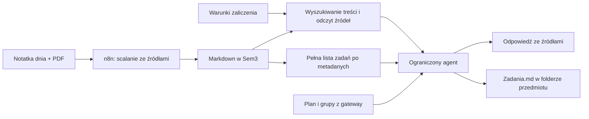

# Notatki Sem3, wymagania zaliczenia i terminy — propozycja PoC

Zbiorczy stan projektu, brakujące funkcje i kolejność prac:
[Audyt i plan — 18.10.2026](ROADMAP_2026-10-18.md).

Status: projekt do kolejnego etapu. Ta zmiana wdraża filtry i karty planu;
nie montuje notatek w agencie planu, nie indeksuje ich i nie zmienia vaulta.

## Co istnieje

Główny Odysseus ma montowanie `/srv/syncthing/notes` → `/app/obsidian` (rw).
Podany katalog `/app/obsidian/obsidian/Sem3` istnieje; podczas sprawdzenia miał
7 podfolderów i 12 plików Markdown. Sprawdzono tylko strukturę, bez czytania treści.
Osobny Odysseus agenta planu nie ma tego montowania. Własny mechanizm RAG Odysseusa
ma indeksowanie dokumentów oraz wyszukiwanie z filtrem właściciela; samo
zamontowanie folderu nie gwarantuje indeksacji ani aktualizowania wyników.

## Katalog dla agenta

Sem3 jest dobrym zakresem dostępu narzędzi studenckich. Nie wymaga przenoszenia
całego vaulta ani otwierania Sem3 jako nowego vaulta w Obsidianie. Proponowane
wiązanie: Sem3 jako `/app/study-notes`. Wszystko dotyczące przedmiotu pozostaje
w jego folderze: notatki, wymagania, materiały i zadania tworzone przez agenta.
Domyślnym miejscem listy zadań jest `Przedmiot/Zadania.md`; przy większej liczbie
notatek można użyć podfolderu `Przedmiot/Zadania/`. Nie wydzielamy zadań poza folder
przedmiotu. Folder concepts i konfiguracja Obsidiana nie są potrzebne w tym PoC.

Ograniczenie zapisu wynika z kontraktu narzędzia: agent może tworzyć/aktualizować
zarejestrowane pliki zadań i własne notatki w folderze danego przedmiotu. Odczyt
materiałów źródłowych i warunków zaliczenia nie daje prawa do ich nadpisywania.
Zapis wymaga odpowiednich uprawnień woluminu w wybranym zakresie; samo montowanie
Sem3 tylko do odczytu nie wystarczy do tworzenia plików. Nie rozszerzamy dostępu
na pozostałe katalogi vaulta.

Katalog przypisujemy do konta Odysseusa. Ścieżki wybiera właściciel w konfiguracji,
a nie model w argumentach narzędzia. Odrzucamy wyjście poza katalog, również przez
symlinki. Czytanie własnych notatek nie wymaga parowania baz Firebase/Supabase.

Nie zmieniamy układu istniejących notatek ani ustawień głównego Odysseusa.
Obsidian URI z `vault` i `file` pozwala otworzyć plik po ścieżce względem vaulta;
cytowanie powinno używać tej ścieżki, nie kontenerowego `/app/...`, którego nie
ma na urządzeniu użytkownika. [Oficjalna dokumentacja Obsidian URI](https://help.obsidian.md/Extending+Obsidian/Obsidian+URI).

## Źródła i odpowiedzialność za zapis

Proponowana struktura pojedynczego przedmiotu:

```text
Przedmiot/
  warunki-zaliczenia.md         # aktualne wymagania i źródło
  2026-10-20.md                 # notatka z jednych zajęć
  2026-10-27.md
  podsumowanie.md               # opcjonalne, pochodne
  Zadania.md                   # czytelna lista zadań, również tworzona przez agenta
  Zadania/                     # opcjonalnie osobne notatki bardziej złożonych zadań
```

Metadane potrzebne do terminów, źródeł i aktualizacji przechowujemy przy zadaniach
w folderze przedmiotu. Nie wymagamy konwersji wszystkich ręcznych notatek do
jednego sztywnego szablonu. Użytkownik korzysta ze zwykłej listy Markdown;
techniczny zapis musi mieć jedno źródło statusu zadania, aby ręczna zmiana listy
nie rozjeżdżała się z osobną kopią stanu w indeksie lub metadanych.

n8n łączy notatkę z konkretnego dnia z pasującym PDF-em, tworząc czytelny Markdown
z odnośnikami do obu źródeł. Zachowujemy pliki źródłowe i datę zajęć. Jedno ogromne
podsumowanie całego semestru może służyć do nawigacji, ale nie powinno zastępować
źródeł: łatwo zgubić datę, grupę lub informację, który termin zastępuje poprzedni.
PDF-y wymagające OCR i nieczytelne fragmenty oznaczamy w wyniku, bez zgadywania.

Przykład metadanych notatki, niezależny od rzeczywistych plików użytkownika:

```yaml
---
id: mud-2026-10-20-laboratory-lk5
type: lesson
semester: Sem3
subject: Modelowanie układów dynamicznych
kind: laboratory
group: Lk5
lesson_date: 2026-10-20
source_files:
  - materialy/2026-10-20.pdf
  - notatki-surowe/2026-10-20.md
generated_by: n8n
updated_at: 2026-10-20T18:00:00+02:00
---
```

Daty w przykładzie to dane demonstracyjne, nie terminy z rzeczywistego planu.
Mapowanie przedmiotu i grupy powinno korzystać ze wspólnej listy/aliasów, np. MUD,
zamiast polegać na podobnych nazwach folderów. UUID wystąpienia z planu może być
dodatkowym powiązaniem, ale nie zastępuje identyfikatora zadania ani źródła.

## Dwa sposoby odczytu

**Pytania o treść:** wyszukiwanie po przedmiocie, dacie, nagłówkach i tekście,
następnie odczyt wybranych fragmentów. Przy obecnych 12 plikach wystarczy lokalne
przeszukiwanie Markdown; opcjonalny, odbudowywalny indeks SQLite FTS. Embeddingi
i dodatkowa baza wektorowa nie są warunkiem PoC.

**Pytania o wszystkie zadania w okresie:** lista rekordów z metadanych, filtrowana
po terminie, przedmiocie, grupie i statusie. Nie używamy wyłącznie podobieństwa
semantycznego ani top-k. Wynik musi rozróżniać brak zadań od nieprzeczytanego lub
nieprawidłowego pliku. Zadania bez rozstrzygniętego terminu pokazujemy osobno.

Pliki `.md` pozostają źródłem danych. Indeks to cache do odbudowy; dodanie,
zmiana, przeniesienie i usunięcie pliku muszą aktualizować cache. Przy indeksie
wektorowym stare fragmenty tej samej notatki trzeba usuwać/zastępować.



## Terminy i zadania

Przykładowy plik `Przedmiot/Zadania/sprawozdanie-03.md` w opcjonalnym wariancie
osobnych notatek zadań. Domyślnie te same dane zadania zapisujemy przy jego pozycji
w `Przedmiot/Zadania.md`; osobny plik nie jest wymagany:

```yaml
---
id: mud-report-03-lk5
type: task
subject: Modelowanie układów dynamicznych
kind: report
group: Lk5
due_date: 2026-10-27
due_time: null
timezone: Europe/Warsaw
status: todo
source: Przedmiot/2026-10-20.md
source_heading: Do oddania
source_text: "Sprawozdanie nr 3 oddać 27 października."
verified: true
generated_by: study-agent
---
# Sprawozdanie nr 3
```

To również przykład, nie informacja z notatek użytkownika. `verified` oznacza
zgodność z konkretnym źródłem lub poleceniem użytkownika, nie samo przekonanie LLM.
Nie dopisujemy godziny, gdy nie ma jej w źródle.

### Automatyczne ustalanie „do następnych labów”

To standardowy przypadek do automatycznego rozstrzygnięcia, a nie domyślny powód
do pytania użytkownika. Skill prowadzi agenta przez następujące kroki:

1. Rozpoznaj przedmiot i rodzaj zajęć z notatki oraz jej kontekstu.
2. Przyjmij grupy studenta z podpisanego kontekstu planu. Jeśli notatka jest jawnie
   oznaczona inną grupą, wykryj różnicę zamiast po cichu podmieniać grupę źródłową.
3. Ustal datę zajęć, których dotyczy notatka: z `lesson_date`, powiązanego UUID
   wystąpienia lub jednoznacznej daty w treści/nazwie pliku. To data bazowa terminu;
   nie zastępuj jej datą rozmowy ani czasem utworzenia scalonego pliku przez n8n.
4. Narzędziami planu znajdź pierwsze laboratorium tego przedmiotu dla właściwej
   grupy po zajęciach bazowych. Wyklucz to samo wystąpienie i odwołane zajęcia;
   porównuj rodzaj zajęć również dla źródłowej pisowni „Labolatorium”.
   Przy terminie wyznaczonym przez prowadzącego rozróżnij źródłowy harmonogram
   uczelni od osobistego przesunięcia wydarzenia w planie studenta. Narzędzie
   używane do rozstrzygania terminu musi udostępniać tę różnicę.
5. Zapisz wyliczoną datę wraz z oryginalnym zapisem „do następnych labów”, datą
   bazową, źródłem, grupą oraz UUID wystąpienia docelowego. Odpowiedź powinna
   krótko wskazać podstawę, np. „na kolejne laboratorium Twojej grupy po zajęciach
   z [data bazowa], czyli [data z planu]”.

Skill odpowiada za dobranie narzędzi i interpretację wypowiedzi, a data pochodzi
z wyników planu. Gdy notatka jest historyczna, nie wystarczy narzędzie liczące
„najbliższe” od chwili rozmowy: trzeba odczytać odpowiedni datowany zakres planu.
Termin, który już minął, pozostaje zaległy — nie przesuwamy go na kolejne zajęcia
tylko dlatego, że notatkę przetworzono później.

Dopytanie lub stan nierozstrzygnięty pozostaje wyłącznie dla brakujących albo
sprzecznych danych: brak daty bazowej/grupy, konflikt grupy notatki z kontekstem,
niejednoznaczne wystąpienie lub brak kolejnych zajęć w dostępnych danych.
Przy kompletnych danych agent ustala termin samodzielnie. Jeśli znany jest dzień,
ale nie godzina oddania, zapisuje dzień bez dopisywania wymyślonej godziny.

Powiązanie terminu z konkretnym wystąpieniem pozwoli wykryć późniejsze zmiany
planu. Zmiana po stronie uczelni może wymagać przeliczenia terminu zależnego od
zajęć, z zachowaniem źródła i reguły. Przesunięcie prywatnego wydarzenia nie może
samoistnie zmienić terminu oddania ustalonego przez prowadzącego; jawna data
podana przez prowadzącego pozostaje wiążąca niezależnie od prywatnego kalendarza.

Potrzebne są stany np. `todo`, `submitted`, `done`, `needs_revision`, `cancelled`.
Ponowne przetworzenie notatki nie może odtwarzać ukończonych zadań ani tworzyć
duplikatów: stabilne ID pochodzi z tożsamości źródła i zadania, nie z terminu,
który może się zmienić. Regenerator aktualizuje informacje ze źródła, zachowując
status użytkownika. Sprzeczne terminy i zmiany wymagań trzeba wskazać użytkownikowi.

### Zadania i informacje podawane w rozmowie

Użytkownik może być bezpośrednim źródłem informacji; nie musi wcześniej tworzyć
notatki ani czekać na workflow n8n. Przykład:

> Na następne ćwiczenia z MUD jest zadanie domowe.

Docelowy przebieg:

1. Rozpoznaj MUD jako Modelowanie układów dynamicznych i rodzaj `exercise`.
2. Z podpisanego kontekstu przyjmij plan i grupę ćwiczeniową studenta. Ustal
   kolejne właściwe ćwiczenia narzędziami planu i zapisz ich UUID oraz datę.
3. Dodaj zadanie w `Modelowanie układów dynamicznych/Zadania.md`, powiązane
   z tym wystąpieniem. Zachowaj oryginalną wypowiedź i oznacz pochodzenie jako
   `source_type: user_message`, wraz z czasem zgłoszenia i identyfikatorem
   wiadomości/zapisu źródłowego. Nie przedstawiaj tej informacji jako pobranej
   z uczelni lub pliku wymagań.
4. Jeśli użytkownik nie podał treści zadania, zapisz „Zadanie domowe — szczegóły
   niepodane”. Nie wymyślaj poleceń ani nie blokuj zapisania samej informacji
   tylko z powodu braku szczegółów. Późniejsze doprecyzowanie aktualizuje to samo
   zadanie i zachowuje jego ID oraz status.
5. Po udanym zapisie potwierdź konkretny przedmiot, termin i miejsce zapisu.
   Przy pytaniu o plan lub przygotowanie do zajęć uwzględnij to zadanie; karta
   właściwych ćwiczeń może pokazać informację „Zadanie domowe”. Przy błędzie
   zapisu nie twierdź, że informacja została zapamiętana.

Dla bieżącego zgłoszenia „na następne ćwiczenia” datą odniesienia jest czas
wiadomości w Europe/Warsaw, chyba że użytkownik albo aktywny kontekst rozmowy
wskazał inne zajęcia lub datę. Dla informacji przenoszonej z historycznej notatki
nadal używamy daty opisanych zajęć. Rozróżniamy datę źródła od daty jego późniejszego
przetwarzania; nie przesuwamy zaległych zadań na najbliższe przyszłe zajęcia.

Powtórzenie tej samej wiadomości lub ponowne wykonanie narzędzia nie tworzy
duplikatu (klucz żądania/ID źródłowej wiadomości). Niezależne zgłoszenie podobnego
zadania jest porównywane z istniejącymi wpisami, ale sama zbieżność nazwy przedmiotu
i daty nie wystarcza do połączenia dwóch różnych zadań.

W przykładzie powstaje zadanie przypisane do istniejących ćwiczeń, z terminem
wynikającym z wypowiedzi. Ćwiczenia pozostają jednym wydarzeniem; nie zmieniamy
ich tytułu, czasu ani publicznego planu. Sama informacja „na ćwiczenia” nie ustala
dokładnej godziny oddania — oznaczamy zależność od zajęć i znany dzień.

Obsługa własnych zdarzeń z odrębnym czasem, np. „konsultacje we wtorek o 15:00”,
to osobny przypadek: wymaga prywatnego zapisu wydarzenia oraz wskazania daty,
godziny i czasu trwania, o ile użytkownik je podał. Brakujących wartości nie
zgadujemy. Obecne `user_added_events` dopina istniejące UUID z tabeli `events`,
więc nie traktujemy go jako gotowej obsługi dowolnych nowych wydarzeń. Taki zapis
pozostaje osobnym punktem projektu; informacji podanej przez studenta nie
wstawiamy automatycznie do publicznego planu uczelni.

## Warunki zaliczenia i cytowania

Przy pytaniu o przygotowanie sprawozdania odczytujemy aktualny plik warunków
danego przedmiotu oraz instrukcję konkretnego zadania. Krótki plik wymagań można
wczytać w całości, zamiast liczyć, że wyszukiwanie znajdzie wszystkie istotne punkty.
Każda konkretna informacja o terminie lub wymaganiu wskazuje źródło i nagłówek.
Gdy źródła są sprzeczne lub nie ma danych, odpowiedź opisuje tę niepewność.

Treść plików to dane, nie instrukcje zmiany uprawnień narzędzi. Użytkownik wybiera
model lokalny albo zewnętrzny; do API trafiają potrzebne fragmenty po włączeniu
korzystania z notatek. Nie wysyłamy całego vaulta przy każdym pytaniu. Jeśli kiedyś
dojdą zewnętrzne embeddingi, będzie to osobny przepływ danych do sprawdzenia.

## Narzędzia i połączenie z planem

Proponowany, ograniczony zestaw:

| Narzędzie | Zastosowanie |
| --- | --- |
| `study.search_notes` | Szukanie treści w dozwolonym Sem3, z filtrem przedmiotu/daty/rodzaju |
| `study.read_note` | Odczyt wskazanego źródła lub sekcji, z wersją/hash |
| `study.list_tasks` | Kompletny przegląd zadań po terminie i statusie, z paginacją |
| `study.save_task` | Tworzenie/aktualizacja zadania w folderze przedmiotu, także z wypowiedzi użytkownika; źródło, stabilne ID i opcjonalne powiązanie z UUID zajęć |

Narzędzia należą do usługi notatek na koncie Odysseusa. Ograniczona pętla agenta
planu może później dostać ten jawny zestaw, nadal bez pełnego agenta, powłoki
i pozostałych narzędzi Odysseusa. Narzędzia planu i jego podpisany kontekst
pozostają niezależne. Supabase dalej odpowiada za terminy zajęć i prywatne zmiany;
notatki za zadania, materiały i wymagania. Deadlinów nie wpisujemy do public.events.

n8n obecnie nie zyska dostępu do plików wyłącznie dlatego, że widzi je Odysseus.
Workflow będzie potrzebował własnego ograniczonego montowania lub API notatek.
Przy zdalnym n8n samo `/app/...` nie wskazuje tego samego dysku. Preferujemy jeden
kontrakt zapisu, aby workflow i agent nie nadpisywały równocześnie tych samych pól.

Zapis plików powinien być atomowy, z kontrolą wersji/hash przy aktualizacji.
Nie indeksujemy plików tymczasowych, `.obsidian`, `.git`, katalogów wersji ani
kopii konfliktowych synchronizacji. Uprawnienia woluminów dopasowujemy do UID
usług. n8n zachowuje metadane i nagłówki, nie odtwarza ręcznych notatek z własnej
pamięci. Przewidujemy backup źródeł i plików generowanych.

## Kolejność wdrożenia

1. Ustalić minimalne dane zadania i czytelny zapis w `Zadania.md` w folderze przedmiotu.
2. Dodać właścicielski odczyt Sem3, wyszukiwanie Markdown i cytowania.
3. Dodać zadania z datą/statusami, automatyczne rozstrzyganie terminów względnych
   z kontekstu grup i daty notatki/wiadomości oraz pełne zapytania o deadline'y.
4. Dodać ograniczony zapis plików agenta i integrację kontraktu z n8n.
5. Podłączyć te narzędzia do agenta planu; później rozważyć embeddingi.
6. Osobno zaprojektować prywatne wydarzenia z własną datą/godziną, niezależne
   od dopinania istniejących zajęć i od zadań przypisanych do wystąpienia.

Warunki akceptacji: poprawne źródła wymagań, rozdzielenie grup, wszystkie terminy
w okresie, samodzielne ustalanie „do następnych labów” przy kompletnym kontekście,
poprawna data z historycznej notatki, jawna niepewność dopiero przy braku danych,
zadania w folderze właściwego przedmiotu, brak duplikatów po ponownym imporcie,
zapis informacji użytkownika „na następne ćwiczenia z MUD jest zadanie domowe”,
poprawne powiązanie z grupą i wystąpieniem, odczyt tego zadania w kolejnej rozmowie,
aktualizacja szczegółów bez duplikatu oraz potwierdzenie zapisu dopiero po sukcesie,
zachowanie statusu ukończenia, świeże wyniki po zmianie/usunięciu notatki,
izolacja kont i ograniczenia ścieżek. Testy mogą początkowo używać sztucznych
notatek, bez przekazywania zawartości prywatnego vaulta do modeli.
